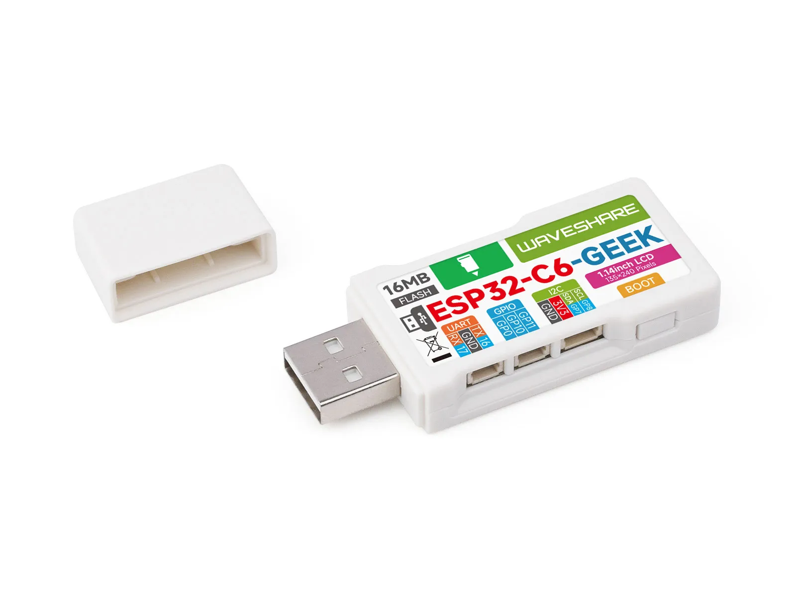

# Waveshare ESP32-C6-GEEK

[中文](README_ZH.md)

The ESP32-C6-GEEK is a compact development board designed by Waveshare for makers and embedded developers. It is built around the ESP32-C6, featuring a 32-bit RISC-V processor running at up to 160 MHz, 16 MB Flash, 2.4 GHz Wi-Fi 6, Bluetooth 5 (LE), and IEEE 802.15.4 connectivity. The board integrates a 1.14-inch 240 × 135 IPS LCD, a Micro SD card slot, a USB-A male connector, and UART, GPIO, and I2C headers, making it suitable for wireless applications, portable tools, and embedded display projects.

- [Purchase Link](https://www.waveshare.com/esp32-c6-geek.htm)
- [Documentation](https://docs.waveshare.com/ESP32-C6-GEEK)



## Repository Structure

This repository provides examples, factory firmware, and hardware design files for the ESP32-C6-GEEK.

```text
.
├── example/         # Arduino and ESP-IDF examples
├── firmware/        # Factory firmware
├── hardware/        # Schematics
├── LICENSE          # Apache License 2.0
├── README.md        # English documentation
└── README_ZH.md     # Chinese documentation
```

## Getting Started

The [examples for currently shipping boards](example/ESP32-C6-GEEK_V2-Demo/) include Arduino and ESP-IDF projects for the LCD, Micro SD card, buttons, Wi-Fi, Bluetooth, MQTT, and LVGL. See [`firmware/`](firmware/) for factory firmware and [`hardware/schematics/`](hardware/schematics/) for schematics.

For development environment setup, flashing instructions, pin mappings, and example usage, refer to the [documentation page](https://docs.waveshare.com/ESP32-C6-GEEK).

## Contributing

We welcome contributions! Here's how you can help:

1. Fork the repository.
2. Create a new branch for your feature or bug fix.
3. Commit your changes with clear descriptions.
4. Submit a pull request for review.

## Issues and Support

Open an [issue](https://github.com/waveshareteam/ESP32-C6-GEEK/issues) with detailed information, or contact the Waveshare team with your order number for technical support.

## License

Licensed under the Apache License 2.0. See the [LICENSE](LICENSE) file for details.

---

Thank you for using Waveshare Electronics products!
